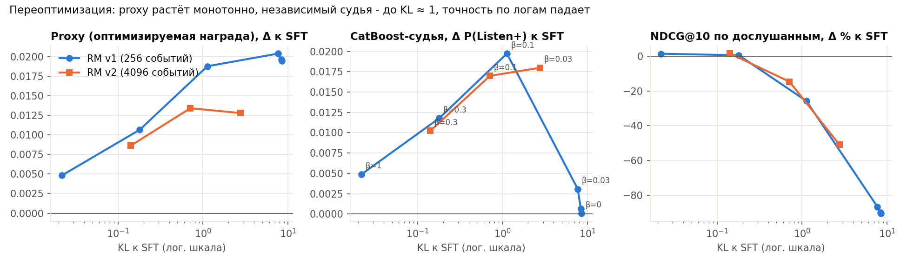
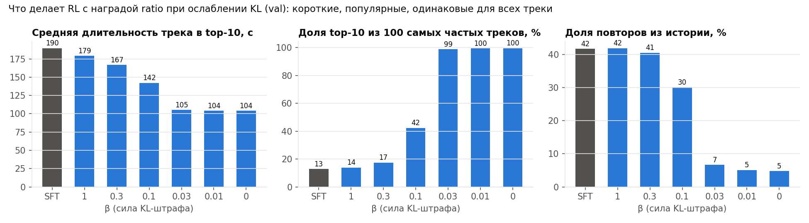
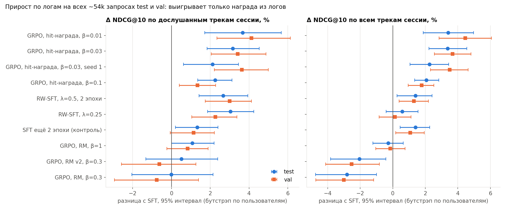
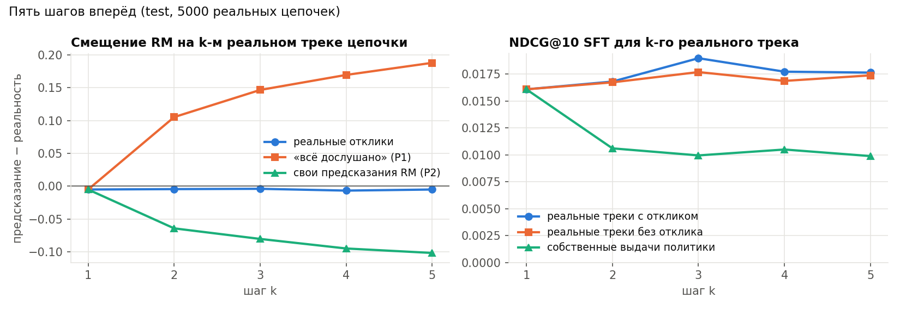

# RL-дообучение последовательного рекомендателя на Yambda

GPT-2 предсказывает следующий трек, reward model предсказывает долю дослушивания, GRPO дообучает генерацию. Главный вопрос - становятся ли рекомендации лучше на самом деле, а не только по мнению reward model.

Подробное описание решения со всеми таблицами: [docs/REPORT.md](docs/REPORT.md). Запуск и проверка цифр: [docs/REPRODUCE.md](docs/REPRODUCE.md).

## Коротко

1. **RL с выученной reward model взламывает награду.** При слабом KL-штрафе политика уходит в короткие популярные треки, одинаковые для всех: длительность 190 → 104 с, 99.7% выдачи - топ-100 треков, NDCG падает в 10 раз. Proxy-награда при этом максимальна.
2. **Переоптимизация подтверждена независимым судьёй.** CatBoost из первого задания (другая модель, другие признаки) растёт вместе с KL до KL ≈ 1, а потом падает до уровня SFT. Это картина Gao et al. (2022) на рекомендациях.
3. **Защиты (CE-якорь, пессимизм ансамбля, нормировка по длительности, RM с длинной историей) не сдвигают компромисс**, а лишь замедляют движение вдоль одной кривой «KL → качество». Причина в данных: reward model различает треки внутри одного контекста почти только по длительности (AUC внутри сессии 0.60 против 0.58 у модели, которая трек не видит).
4. **Тот же GRPO с наградой из логов работает.** Если награда - «попал ли трек в реальное будущее сессии», GRPO значимо улучшает метрики по логам на test и val (+2…+6% к SFT, ~54k запросов, поправка на множественные сравнения), не трогая длительность, и воспроизводится на другом seed. Из этого прироста около 1% даёт просто дополнительное обучение (контроль: SFT ещё 2 эпохи), ещё +2…+3% - именно RL. Провал был в выученной награде, а не в RL.
5. **Офлайн нельзя проверить, понравится ли новое.** Логи видят только то, что показывал старый рекомендатель, а CatBoost - тоже модель, обученная на этих логах. Два офлайн-судьи расходятся: CatBoost предпочитает политики с RM, логи - политику с наградой из логов. Окончательный ответ даст только A/B-тест.



---

## 1. Данные и разбиение

- **Yambda-50M** (Яндекс Музыка): прослушивания с долей дослушивания `played_ratio_pct`, флагом органики и длительностью трека.
- **Глобальное временное разбиение**, как в первом задании: test - последние 7 дней, val - 7 дней до них, train - всё раньше. Контексты для RL - дни 14-27 (внутри train).
- **Каталог** - 50 000 самых частых треков по train (80% прослушиваний), остальные - токен UNK.
- **Запрос** - позиция рекомендательного события; контекст - всё до него. **Listen+** - дослушано ≥ 50%.

**Защита от утечек.** Всё, что обучается (SFT, reward model, GRPO), видит только события train: обучающие окна обрезаются по концу train каждого пользователя, контексты RL берутся из дней 14-27, будущее сессии для hit-награды тоже обрезается по концу train. Каталог и популярность треков считаются только по train, границы бинов заданы константами. Метка «продолжение сессии» у последнего события train считается неизвестной, если следующее событие уже в val/test. Запросы val и test берутся строго из своих дней.

## 2. Модели

### Политика: GPT-2 + SFT
Событие кодируется суммой эмбеддингов всех полей, так модель видит не только *что* слушал пользователь, но и *как*:

$$x_t = E_{\text{item}}[i_t] + E_{\text{artist}}[a_t] + E_{\text{ratio}}[b^{\text{ratio}}_t] + E_{\text{org}}[o_t] + E_{\text{dur}}[b^{\text{dur}}_t] + E_{\text{gap}}[b^{\text{gap}}_t]$$

GPT-2 (4 слоя × 256, контекст 256 событий, HF `transformers`), выход - softmax по каталогу с общей таблицей эмбеддингов. SFT - cross-entropy на следующий трек; корзина отклика с вероятностью 0.15 заменяется на «неизвестно», чтобы модель умела работать с собственными сгенерированными треками. Модель 8 × 512 дала то же качество.

| Test, 10k запросов | Recall@10 | NDCG@10 | NDCG@10 по дослушанным в сессии |
|---|---|---|---|
| MostPop | 0.006 | 0.003 | 0.006 |
| «недавно слушал» | 0.036 | 0.025 | 0.028 |
| **SFT** | **0.046** | 0.023 | **0.033** |

### Reward model
Отдельная GPT-2 (инициализация весами SFT: у RM v1 - большой SFT 8 × 512, у RM v2 - базовой 4 × 256) с MLP-головой над `[состояние, кандидат, состояние ⊙ кандидат, признаки совпадения]`. Признаки совпадения - 16 счётчиков «этот трек / этот артист в истории» с затуханием 1 час / 1 день / 30 дней. Выход: доля дослушивания (мягкая BCE с целью ratio/100) и вероятность продолжения сессии. Ансамбль из 5 моделей: член 0 - proxy для RL, члены 1-4 (бутстрэп) - внутренний судья и оценка неуверенности. Плюс базовая модель, которая не видит сам трек.

| Отложенные показы (val) | AUC Listen+ | GAUC по пользователям | AUC внутри сессии |
|---|---|---|---|
| базовая модель (без трека) | 0.908 | 0.714 | 0.579 |
| **RM v1** (энкодер 8 × 512, история 256 событий) | **0.909** | 0.723 | 0.598 |
| RM v2 (энкодер 4 × 256, история 4096 событий) | 0.910 | 0.730 | 0.612 |
| CatBoost из задания 1 (test) | 0.916 | 0.755 | - |

RM v2 меньше, но различает треки внутри сессии лучше: решает длинная история, а не размер энкодера.

Высокий AUC почти целиком объясняется состоянием пользователя («сейчас пролистывает»), которое одинаково для всех кандидатов. Для RL важно ранжирование кандидатов внутри контекста, а там RM лишь немного лучше модели, не видящей трек.

### GRPO
Для контекста $x$ политика генерирует группу из $G$ слейтов по $K = 5$ треков (авторегрессивно, без повторов). Награда слейта $R = \sum_{j} \gamma^{j-1} r(x, a_j)$, $\gamma = 0.9$; каждый трек оценивается при реальной истории. Преимущество нормируется внутри группы, KL к SFT считается точно по всему каталогу:

$$\mathcal{L} = -\frac{1}{BG}\sum_{b,g} \frac{R_{bg} - \bar R_b}{\mathrm{std}_b R + \varepsilon}\sum_{j}\log \pi_\theta(a_{bgj} \mid x_b, a_{bg,\lt j}) + \beta \frac{1}{BG}\sum_{b,g,j} \mathrm{KL}\big(\pi_\theta  \Vert  \pi_{\text{SFT}}\big)$$

Один шаг градиента на батч (клиппинг PPO не нужен), $B = 64$, $G = 8$ (16 для hit), lr $2\cdot10^{-5}$, 600 шагов. GRPO, генерация слейтов, точный KL и reward model реализованы с нуля в `rl/`, из `transformers` берётся только архитектура GPT-2.

| Награда $r(x, c)$ | Формула |
|---|---|
| `ratio` | $\hat r_0(x, c)$ - доля дослушивания по proxy |
| `seconds` | $\hat r_0 \cdot \text{dur}(c)/240$ |
| `norm` | $\hat r_0 - \hat b(x, \text{dur})$ - сверх ожидаемого для такой длины |
| `pess` | среднее ансамбля − стд. ансамбля |
| `continue` | $P(\text{сессия продолжится})$ - прокси удержания |
| **`hit`** | $\max_{t \in \text{будущее сессии}} \mathbb{1}[c = i_t]\cdot \text{ratio}_t/100$ - **из логов, без RM** |

Защиты: CE-якорь на реальных окнах (как ptx в InstructGPT), смешивание с hit-наградой, пессимизм, нормировка. Контроли без RL: **Best-of-N** из SFT, у которого $\mathrm{KL} \le \log N - \frac{N-1}{N}$, и **reward-weighted SFT**, где лосс умножается на $\exp(\text{ratio}/\lambda)$.

## 3. Как оценивается

- **Логи:** NDCG/Recall@10 для следующего трека, для всех треков сессии и только для **дослушанных** (главная метрика релевантности: следующий трек - это часто скип, который старый рекомендатель поставил зря).
- **Поведение:** длительность, популярность, доля повторов из истории, доля топ-100, покрытие каталога, Gini, персонализация.
- **CatBoost-судья:** модель из первого задания (171 признак, Listen+). Для трека из выдачи политики создаётся синтетический пользователь - его реальная история плюс одна строка с этим треком, и признаки считает код первого задания без изменений. Точно воспроизводит сохранённые предсказания первого задания для 97.8-98.3% реальных треков. На test он не видел данных при обучении.
- **Статистика:** парный бутстрэп по пользователям (все модели на одних и тех же запросах), для итоговых выводов - все ~54k запросов test и val, 2000 повторов и поправка Холма на множественные сравнения.

## 4. Результаты

### 4.1. Поведение после RL: взлом через короткие треки


RM выучила, что короткие треки дослушивают чаще (это правда, но не значит, что они нравятся больше). С ослаблением KL политика отдаёт всё больше выдачи коротким популярным трекам и перестаёт рекомендовать знакомое. При β ≤ 0.03 выдача почти одинакова у всех пользователей. Награда `seconds` взламывается в обратную сторону - длинные треки (390 с). Награда `continue` тоже укорачивает треки (121 с): короткий трек быстрее заканчивается, и сессия «продолжается».

### 4.2. Переоптимизация и компромисс (рисунок вверху, val)
| Запуск | KL | Proxy | CatBoost, Δ | NDCG дослушанных, Δ | Длит., с |
|---|---|---|---|---|---|
| SFT | 0 | 0.686 | 0 | 0 | 190 |
| ratio β=1 | 0.02 | 0.690 | +0.005 | +1.5% | 179 |
| ratio β=0.3 | 0.18 | 0.696 | +0.012 | +0.6% | 167 |
| ratio β=0.1 | 1.13 | 0.704 | **+0.020** | −26% | 142 |
| ratio β=0 | 8.46 | 0.705 | 0.000 | −90% | 104 |
| CE-якорь + hit, β=0.1 | 0.54 | 0.700 | +0.015 | −11% | 155 |
| pess, β=0.1 | 0.94 | 0.703 | +0.018 | −19% | 146 |
| norm, β=0.1 | 0.54 | 0.696 | +0.013 | −16% | 189 |

Все защиты с выученной RM ложатся на одну кривую по KL: они лишь укорачивают шаг. RM v2 с длинной историей откладывает коллапс (при β=0.03 KL 2.8 вместо 7.7, судья +0.018 вместо +0.003), но кривую не сдвигает. Best-of-N из SFT получает больше proxy при меньшем KL, чем GRPO: N=16 (KL слейта ≤ 1.8) даёт proxy слейта 2.863, а GRPO β=0.1 при KL 5.1 - 2.837; N=64 (KL ≤ 3.2) - 2.894, больше, чем GRPO без KL-штрафа (KL 40).

### 4.3. Реальный прирост по логам: решает награда


| Все ~54k запросов, Δ к SFT | NDCG дослушанных, сессия: test / val | NDCG всех, сессия: test / val | NDCG следующего: test / val | CatBoost, test |
|---|---|---|---|---|
| **GRPO, hit-награда, β=0.03** | **+3.2% / +3.4%** | **+3.4% / +3.7%** | **+4.9% / +6.2%** | −0.002 |
| GRPO, hit-награда, β=0.03, seed 1 | +2.1%° / +3.6% | +2.3% / +3.5% | +2.5%° / +5.4% | - |
| GRPO, hit-награда, β=0.01 | +3.7% / +4.1% | +3.4% / +4.5% | +3.5%° / +6.4% | - |
| GRPO, hit-награда, β=0.1 | +2.3% / +1.3%° | +2.1% / +1.8% | +3.1% / +2.9% | 0.000° |
| SFT ещё 2 эпохи (контроль) | +1.3%° / +1.1%° | +1.4%° / +1.1%° | +2.1%° / +1.1%° | - |
| RW-SFT, λ=0.25 | +3.0% / +2.3% | +0.6%° / +0.1%° | −1.0%° / −2.4%° | +0.006 |
| GRPO, RM, β=1 | +1.1%° / +0.8%° | −0.3%° / −0.2%° | −2.0%° / −0.2%° | +0.006 |
| GRPO, RM, β=0.3 (2 seed) | −0.1%° / −0.8%° | −2.8%° / −3.0% | −5.9% / −2.9%° | +0.012 |

° - незначимо после поправки Холма. Остальное значимо.

- **С наградой из логов RL улучшает все метрики релевантности**, без сдвига длительности, и воспроизводится на втором seed. С выученной наградой тот же алгоритм в лучшем случае нейтрален по логам.
- **Это не просто дополнительное обучение.** SFT, дообученный ещё на 2 эпохи, даёт около +1% (незначимо после поправки). Прямое парное сравнение GRPO с hit-наградой против этого контроля: +2.0…+3.4% по NDCG всех треков сессии, значимо на val у всех трёх запусков и на test у двух из трёх (seed 1 на test: +0.9%, незначимо).
- **Reward-weighted SFT** надёжно поднимает угадывание дослушанных (+2…+3%) и органических прослушиваний (+6…+8%), но не NDCG по всем трекам.
- **Два офлайн-судьи расходятся.** CatBoost ставит выше политики с RM и RW-SFT, а GRPO с hit-наградой - чуть ниже SFT. CatBoost предсказывает «дослушает ли показанный трек» и, как наша RM, ценит короткие и популярные треки; логи показывают «выбрал ли пользователь этот трек». Это разные цели, и офлайн нельзя решить, какая ближе к удовлетворённости.

### 4.4. Пять шагов вперёд


На 5000 реальных цепочках из 5 рекомендаций подряд (test):

- **RM как симулятор пользователя портится с каждым шагом.** Если отклик на сгенерированные треки неизвестен и подставляется «всё дослушано», награда к 5-му шагу завышена на +0.19; если подставляются собственные предсказания RM - занижена на −0.10. Обе ошибки в 5-10 раз больше всего выигрыша RL (~0.02), поэтому многошаговую награду офлайн оценивать нельзя, и в RL каждый трек слейта оценивается по реальной истории.
- **Политика теряет 40% NDCG, как только в контексте появляются её собственные треки**, но дальше ошибка не накапливается. Незнание отклика почти ничего не стоит (−3%): помогает выбрасывание отклика при обучении.
- Политики не зацикливаются (повторы внутри слейта запрещены). Порядок политик по награде одинаков при всех способах заполнения откликов, меняется только уровень.

## 5. Ответы на вопросы задания

**1. Как меняется поведение после RL?** Proxy-награда растёт всегда. С выученной RM политика рекомендует более короткие и популярные треки, реже повторяет знакомое, выдачи разных пользователей сближаются вплоть до одного топ-100. Объяснение - смещение RM: длительность - единственный признак кандидата, по которому она уверенно различает треки. С наградой из логов поведение почти не меняется (длительность 187 с), растёт только точность.

**2. Сохраняется ли релевантность?** С выученной RM - только при сильном KL (β ≥ 0.3, и то NDCG по всем трекам теряет 2-6%); при β ≤ 0.1 теряется 11-34%, при β = 0 - 90%, и всем рекомендуются одни и те же треки. С наградой из логов релевантность растёт на 2-6% (из них около 1% - эффект дополнительного обучения).

**3. Долгосрочные цели.** Офлайн-прокси удержания - продолжение сессии (`continue`), отдельная голова RM. Оптимизация её тоже взламывается (ещё более короткие треки). Сигналы в данных: продолжение сессии, возврат в следующие дни, органические прослушивания после рекомендации, лайки. Офлайн можно проверить предсказуемость и калибровку этих сигналов и сдвиг поведения политики; причинный эффект рекомендаций на возврат - нельзя: логи собраны другой политикой и не содержат реакций на непоказанное. Для этого нужен A/B-тест, а для обучения на новом - сбор откликов с exploration.

**4. Пять шагов вперёд.** См. 4.4: симулятор на основе RM ошибается всё сильнее, и способ заполнения неизвестных откликов смещает награду сильнее, чем весь эффект RL; политика один раз теряет 40% точности при переходе к сгенерированной истории.

**5. Компромисс релевантности и награды.** С выученной RM это одна кривая по KL: судья растёт до KL ≈ 1, логи начинают падать гораздо раньше, а защиты лишь сдвигают точку на кривой. Выбор функции награды важнее настроек RL: награда из логов убирает компромисс, но умеет хвалить только то, что пользователь реально слушал.

## 6. Ограничения

- Все выводы офлайн. Логи смещены к тому, что показывал старый рекомендатель; вероятностей показа в Yambda нет, поэтому IPS/doubly robust оценки недоступны.
- CatBoost-судья не истинная награда: он обучен на тех же логах и разделяет часть смещений RM (длительность, популярность).
- Каталог ограничен 50k треками (80% прослушиваний). Модели небольшие (4 × 256); бо́льшая модель качества SFT не дала.
- hit-награда редкая (большинство групп без сигнала) и не может похвалить хорошее новое.
- Для GRPO с hit-наградой два seed только при β=0.03: второй seed слабее на test (+2.3% против +3.4%). Чистый вклад RL сверх дообучения - +1…+3%, у границы мощности даже на 54k запросах.

## 7. Что дальше

- **Длинная история в политике.** 57% следующих треков пользователь уже слушал, но только 11.5% из них в последних 256 событиях. Копирующий механизм или кандидаты из полной истории - самый большой резерв NDCG.
- **Награда = hit + выученная RM с пессимизмом**, чтобы хвалить и подтверждённое логами, и осторожно - новое.
- **Онлайн:** A/B-тест лучших политик (RW-SFT, GRPO hit, ratio β=0.3) с метриками удержания и сбор откликов на exploration для итеративного обучения RM.

## Воспроизведение

Пошаговый гайд: [docs/REPRODUCE.md](docs/REPRODUCE.md). Обучение шло на Kaggle (2×T4), ноутбуки со всеми логами перечислены в гайде.

- **Веса** всех политик, обеих reward model и CatBoost-судьи лежат в **Releases** репозитория (`policies.zip`, `reward_models_v1.zip`, `reward_models_v2.zip`, `catboost_judge.zip`), архивы распаковываются в `outputs/`.
- **Метрики** всех запусков (JSON) и логи Kaggle лежат в `outputs/results/`. Выгрузки top-10 для пересчёта значимости и графиков - `top10_exports.zip` в Releases.
- **Быстрая проверка** после подготовки данных: `python report/significance.py` пересчитывает таблицу 4.3, `python report/make_figures.py` - графики.

```
rl/
    config.py      константы: окна разбиения, каталог, бины признаков, размеры моделей
    prepare.py     события Yambda -> массивы npy, каталог, запросы val/test
    data.py        окна истории, будущее сессии, длинная история для RM v2
    model.py       политика GPT-2, reward model, признаки совпадения с историей
    sft.py         SFT и reward-weighted SFT
    reward.py      обучение и ансамбль reward model, виды награды, hit-награда
    rollout.py     генерация слейтов без повторов, log-prob слейта, история для награды
    grpo.py        GRPO с точным KL к SFT
    evaluate.py    метрики по логам, поведение, proxy, Best-of-N, выгрузка top-10
    multistep.py   пять шагов вперёд: ошибка RM и политики по шагам
    metrics.py     NDCG/Recall, AUC/GAUC, бутстрэп по пользователям
    optim.py       AdamW с прогревом, seed, устройство, fp16
judge/             CatBoost-судья и снимок кода признаков первого задания
report/            графики и стат-тесты
kaggle/            генератор Kaggle-ноутбуков
scripts/           скачивание Yambda
```
